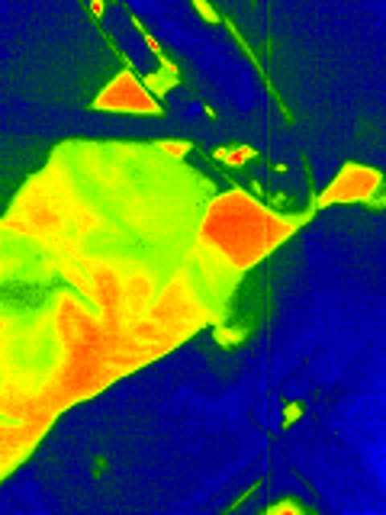

# FLIR ONE Gen 2 Lightning/iOS Windows Viewer

An independent Windows live viewer and radiometric analysis application for the
**FLIR ONE Gen 2 Lightning/iOS** camera. It authenticates the camera through
iAP2, reads the vendor-specific thermal frame interface with WinUSB, and
displays the 160×120 Lepton stream without an iPhone or the discontinued FLIR
mobile application.

## Android APK — preview

The independent Android port has been tested by the project owner with his
Gen 2 Lightning/iOS camera. Download the signed APK from the
[Android 0.3.0 preview release](https://github.com/D-Sefa/FLIR-One-Gen2-Windows/releases/tag/android-v0.3.0-preview).
Android 8.0+ and USB OTG are required; no root, Python, Zadig or FLIR SDK is needed.
**Hardware modification is required for the connection tested here:** open the
camera, remove the Lightning connector and solder a USB data cable in its place
to the corresponding PCB USB data/ground connections. This is a modified camera,
not a plug-and-play solution for an untouched Lightning unit. The APK alone or
an ordinary Lightning charging adapter does not provide this connection.
See the [hardware prerequisite and safety notes](android/README.md#hardware-prerequisite).
After the hardware connection is prepared, install the APK, connect the powered
camera through USB OTG, open the app and allow Android USB access.

Full-window thermal view, auto-hiding controls, palettes/scaling, rotate/mirror,
transparent measurements and MAX graph, date-based playback and PNG export are
included. Recording is **manual only, one rendered JPEG per second**, not new
RAW capture. Live display remains independently full-rate/latest-frame-only.
Saved image colours cannot be reprocessed; existing RAW imports and CSV analysis
remain supported. Optical/MSX is not supported. Other phone models and measured
phone FPS are not verified. See the [Android user guide](android/USER_GUIDE.md).

## Matching desktop / mobile design — Windows 0.4.0

Windows shares Android's deep navy surfaces, restrained mint accents, flat
controls and thin graph lines. Desktop controls, RAW DVR/gallery, calibration,
USB startup and capture behavior are retained; mobile-only recording and
auto-hide choices do not replace the desktop workflows.

## Features

- Live 160×120 radiometric thermal stream on Windows 10/11
- Temperature under the pointer, scene minimum/centre/maximum and measurement points
- Measurement history, hover readout, graph pause/zoom and continuous DVR archive
- Date-organized recording gallery with thumbnails, calendar filters and date/time seeking
- RAW playback with rotation/mirror, palettes/scaling, new measurement points and reanalysis
- Playback speed, seek bar and previous/next recording controls; live archiving continues
- Iron, Lava, Rainbow, White-hot and Black-hot palettes
- Auto plateau HEQ, Detail CLAHE, Linear auto, exact Manual and background-relative scaling
- Fine tone/span, contrast, minimum span, detail and edge-preserving denoise controls
- Smooth or native-pixel display; separate tuning and display resets
- Emissivity, reflected temperature and calibration-offset controls
- Separate **Reset** actions for display and temperature/radiometry settings
- Responsive FPS readout based on the latest two seconds
- Automatic iAP2 session setup, FFC-frame suppression and stream recovery
- One-click Windows launcher and first-run dependency/driver check

## Quick Start

Download the [Windows 0.4.0 release](https://github.com/D-Sefa/FLIR-One-Gen2-Windows/releases/tag/v0.4.0).
The portable Windows ZIP contains **FLIR-One-Gen2.exe** and its dependencies:
no Python installation is required. **First install WinUSB drivers with Zadig**
for the three FLIR interfaces (`MI_00`, `MI_01`, `MI_02`, `VID_09CB&PID_1996`).
Official Zadig 2.9 is included under `drivers/`, together with its source and
license notices. Extract the entire ZIP and double-click the EXE; do not move
the EXE out of its folder. Read the [portable guide](docs/PORTABLE_README.md).

The original Python source distribution with `setup.cmd` is also available.
The following Python installation steps apply only to that source distribution.
When upgrading, close the viewer and rerun `setup.cmd` to install NumPy.
Keep your existing `outputs/FLIR_DVR` folder if you want to retain recordings.

1. Read the [USB connection and complete user guide](docs/USER_GUIDE.md).
2. Connect and power the camera.
3. Install **WinUSB** with Zadig on the three FLIR interfaces whose hardware ID
   is `VID_09CB&PID_1996` (`MI_00`, `MI_01`, `MI_02`). Do not modify unrelated devices.
4. Install Python 3.11 or 3.12.
5. Run `setup.cmd` once.
6. Run `FLIR-One-Gen2-Windows.cmd`.

## Visible/Optical Stream: Help Wanted

The thermal stream is working, but the Gen 2 visible-light camera is not yet
enabled by this project. The device advertises iAP2 protocols named
`com.flir.rosebud.fileio` and `com.flir.rosebud.frame`; however, all thermal
records captured with the current verified startup sequence report
`jpg_size = 0`. Installing WinUSB on all three interfaces is **not** the cause:
those drivers merely allow the application to access the composite USB device.

We welcome help from anyone who has one of the following:

- a reproducible USBPcap/Wireshark capture from a working Gen 2 iOS session;
- verified iAP2/FileIO/Frame commands that enable the 640×480 visual sensor;
- a working legacy SDK sample with corresponding USB traffic;
- analysis of the original Gen 2 native SDK that identifies the visual-stream command.

Please open an issue or pull request. Include hardware/firmware versions,
interface and endpoint information, and a capture or code that others can
repeat. Unverified “magic” control-transfer values are not sufficient evidence.
See [CONTRIBUTING.md](CONTRIBUTING.md).

## Status and Limitations

- Tested with a FLIR ONE Gen 2 Lightning/iOS unit running Rosebud firmware `0.4.27`.
- Thermal capture and analysis work; visible/optical and MSX do not yet work.
- Temperature accuracy depends on the camera calibration and selected radiometric settings.
- Display processing does not improve the sensor's physical resolution or calibration.
- The host-side AGC is independently implemented, not FLIR's proprietary image pipeline.
- Detail mode is locally adaptive: equal colours need not mean equal temperatures.
- A stable battery/power source and reliable USB data connection are essential.
- This is an independent community project and is not affiliated with or endorsed by FLIR.

## Development and validation

See [display algorithms and validation](docs/DISPLAY_PROCESSING.md) and
[release notes](CHANGELOG.md). Run `python -m unittest discover -s tests -v`
inside the setup environment for the offline suite (the UI test requires Tk).

## License

Source code is released under the [MIT License](LICENSE). FLIR and FLIR ONE are
trademarks of their respective owner.
